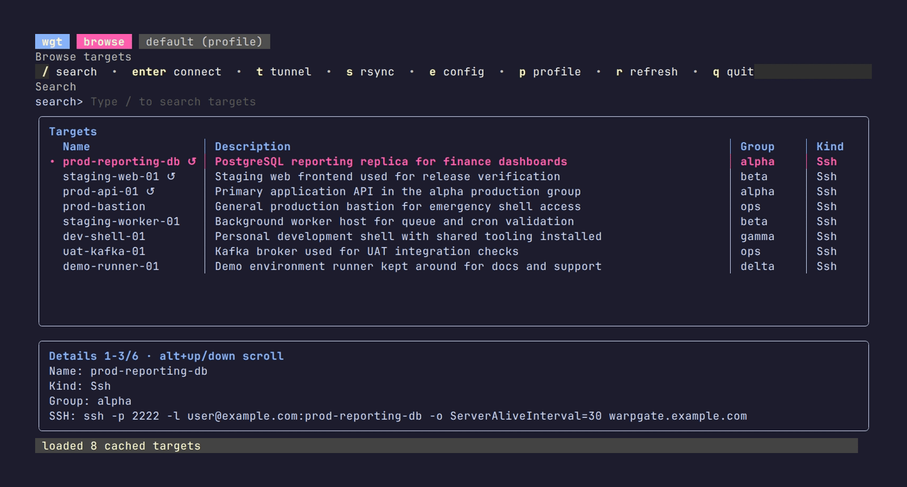

# wgt

A terminal UI for [Warpgate](https://github.com/warp-tech/warpgate) targets: search locally, connect with native SSH, open tunnels, and transfer files with `rsync` or `scp`.

`wgt` caches targets for offline browsing and supports separate upstream profiles. Warpgate handles authentication, authorization, and SSH approval flows.



## Install

Download the binary for your platform from [GitHub Releases](https://github.com/oddship/wg-tui/releases/latest). Linux and macOS builds are available for amd64 and arm64; see the [installation guide](docs/01-guide/02-install-from-release.md) for commands and PATH setup.

With Nix:

```bash
nix run github:oddship/wg-tui
```

See [Nix setup](docs/02-reference/02-nix.md) for installation in NixOS or Home Manager.

## First run

Generate a Warpgate API token in the web UI, then run:

```bash
wgt
```

Onboarding asks for a profile name, server URL, API token, and SSH username. The SSH host can be derived from the server URL. Press `e` later to edit settings or rename the profile.

## Everyday controls

| Key | Action |
| --- | --- |
| `/` | Search targets locally |
| Up/Down or `k`/`j` | Select a target |
| Enter | Connect with SSH |
| `p` | Switch or create profiles |
| `t` | Open a tunnel |
| `s` | Transfer files |
| `e` | Edit settings |
| `r` | Refresh targets |
| `?` | Show keyboard help |
| `q` | Quit |

Escape leaves search while retaining the filter; press it again to clear the filter. Leave search before using letter shortcuts. The header identifies the active profile, for example `default (profile)`.

Each profile keeps its own targets, recent targets, and transfer drafts. Migration and renaming preserve originals and create backups with restore instructions. See [Configuration](docs/02-reference/01-configuration.md) for details.

## Documentation

[Read the docs online](https://oddship.github.io/wg-tui/), or browse the source:

- [Quickstart](docs/01-guide/01-quickstart.md)
- [Target browser and settings](docs/01-guide/04-target-browser.md)
- [SSH, tunnels, and transfers](docs/01-guide/05-connections.md)
- [Configuration and recovery](docs/02-reference/01-configuration.md)
- [Keyboard reference](docs/02-reference/03-keyboard.md)
- [Changelog](docs/03-changelog/index.md)

## Development

Use the Go version declared in [go.mod](go.mod):

```bash
go test ./...
go build -o wgt ./cmd/wgt
```

Read [Architecture](docs/04-development/01-architecture.md), [Contributing](docs/04-development/02-contributing.md), and the [docs capture guide](docs/04-development/03-docs-capture-pipeline.md) before changing those areas.

## License

[MIT](LICENSE).
