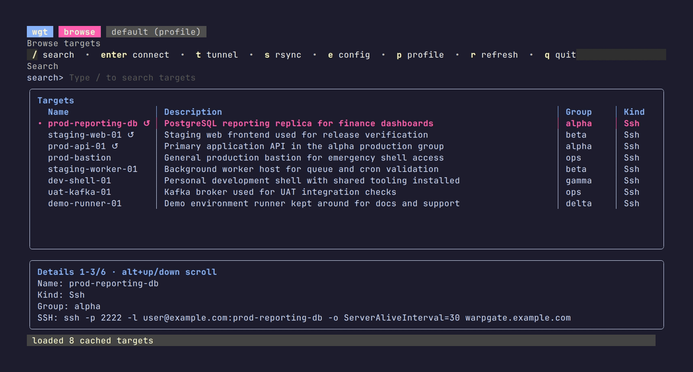

# wgt

A terminal launcher for [Warpgate](https://github.com/warp-tech/warpgate) targets, with local search, cached targets, and separate upstream profiles.

## Get started

Install a [release binary](guide/install-from-release/) or [run with Nix](reference/nix/), then follow the [quickstart](guide/quickstart/). Onboarding sets up your API token and SSH username; `wgt` uses your system SSH client for connections.

## Guides and reference

- [Target browser and settings](guide/target-browser/): search, selection, profiles, table columns, and layout.
- [SSH, tunnels, and transfers](guide/connections/): approval links, local forwards, `rsync`, and `scp`.
- [Configuration](reference/configuration/): HUML fields, profile selection, cache policy, and backup recovery.
- [Keyboard reference](reference/keyboard/): defaults and mode-specific controls.
- [Changelog](changelog/): released and unreleased changes.

## Development

Read [Architecture](development/architecture/), [Contributing](development/contributing/), and the [docs capture guide](development/docs-capture-pipeline/).

[Source on GitHub](https://github.com/oddship/wg-tui)
